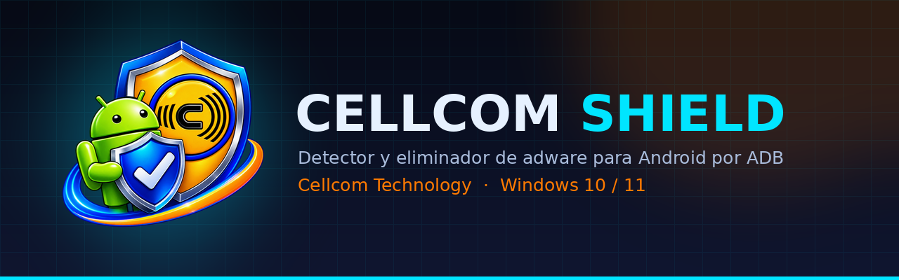
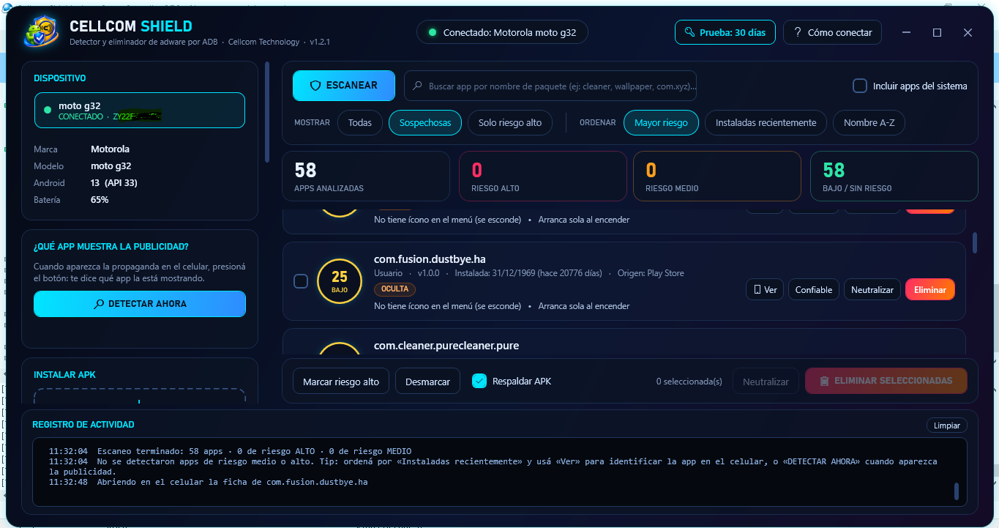

  

  
  
  
  

  <b>Detectá y eliminá en minutos las apps que llenan de publicidad un celular Android: 
  las que se abren solas, se ponen encima de todo, bloquean el touch y no se dejan desinstalar.</b>

  <a href="https://github.com/Sabalero23/CellcomShield/releases/latest"><b>⬇️ Descargar Cellcom Shield para Windows</b></a>

---

## 📸 Capturas

  
   <em>Escaneo de un equipo: las apps más peligrosas aparecen arriba, en rojo, con los motivos.</em>

<table>
  <tr>
    <td width="50%"> <em>Pantalla remota: manejá el celular desde la PC aunque el touch esté bloqueado.</em></td>
    <td width="50%"> <em>«Detectar ahora»: te dice qué app está mostrando la publicidad.</em></td>
  </tr>
  <tr>
    <td width="50%"> <em>Instalación de APK: normal, forzada y con notificaciones bloqueadas.</em></td>
    <td width="50%"> <em>Prueba de 30 días y activación de licencia.</em></td>
  </tr>
</table>

---

## ✨ Qué hace

### 🔍 Detección inteligente de adware
Analiza todas las apps del celular y le asigna a cada una un **puntaje de riesgo de 0 a 100**. Tiene en cuenta si la app:

- se **dibuja encima de otras apps** (superposición), o está mostrando una ventana flotante **en este momento**;
- tiene la **accesibilidad activa**, lo que le permite leer y controlar la pantalla;
- es **administrador del dispositivo**, lo que bloquea su desinstalación;
- **esconde su ícono** del menú;
- se instaló **fuera de la tienda oficial**;
- **arranca sola** al encender, lee las notificaciones o abre pantallas completas;
- tiene un **nombre típico de app basura** (limpiador, booster, linterna…) o un **nombre aleatorio u ofuscado**.

Las de **riesgo alto** quedan arriba, en rojo, y cada una muestra los motivos explicados en castellano.

### 🗑️ Eliminación que sí funciona
Muchas apps de adware no se dejan desinstalar. Cellcom Shield las desarma en el orden correcto:

1. les quita el permiso de **administrador del dispositivo**;
2. les quita la **accesibilidad** y la **lectura de notificaciones**;
3. les bloquea la **superposición** y la ejecución en segundo plano;
4. las **cierra**;
5. las **desinstala**. Si el sistema no lo permite, las deja **desactivadas** para que no se ejecuten más.

Opcionalmente guarda una **copia del APK** en cuarentena antes de borrar.

### 🎯 ¿Qué app muestra la publicidad?
Cuando aparece la propaganda en el celular, tocás **DETECTAR AHORA** y el programa te dice qué app la está mostrando, con un botón para eliminarla en el momento.

### 📱 Pantalla remota
Ves la pantalla del celular en la PC y la manejás con el mouse: **clic** para tocar, **arrastrar** para deslizar y **mantener** para un toque largo. También tenés botones de Atrás, Inicio, Recientes y Encendido, y un campo para escribir texto. Es ideal cuando la publicidad **bloquea el touch**.

### 📦 Instalar APK
Elegís o arrastrás uno o varios `.apk` y los instalás en el equipo conectado:
- **Normal:** instala o actualiza conservando los datos.
- **Forzada:** permite versiones anteriores y APK de prueba, otorga todos los permisos y evita el bloqueo de Play Protect. Si la firma no coincide, reemplaza la app existente.
- **Bloquear notificaciones:** la app queda instalada sin poder mostrar avisos.

### 🧠 Aprende con cada equipo
- **Lista negra:** cada app de riesgo que eliminás queda anotada. Si aparece en el celular de otro cliente, se marca en rojo al instante.
- **Lista blanca:** con el botón «Confiable», una app buena no se vuelve a marcar en ningún equipo.

### 📊 Informes para el taller
Cada acción queda registrada en un **informe mensual** que abre en Excel: fecha, equipo, número de serie, app, acción y resultado.

### 🛡️ Seguro por diseño
- Las apps esenciales del sistema (Ajustes, Teléfono, Google Play Services, etc.) quedan **protegidas** y no se pueden tocar.
- Las apps de fábrica que quites se pueden **restaurar** en cualquier momento.
- Antes de eliminar, siempre te pide confirmación.

---

## 💻 Requisitos

| | |
|---|---|
| **Sistema** | Windows 10 u 11 de 64 bits |
| **Instalación** | No necesita .NET ni nada extra: el instalador trae todo |
| **ADB** | El programa lo descarga solo la primera vez (Android Platform Tools oficial de Google, ~7 MB) |
| **Celular** | Android 5 o superior, con **Depuración USB** activada |
| **Cable** | USB de **datos**, no solo de carga |

---

## 🚀 Instalación

1. Descargá **`CellcomShield-Setup-x.x.x.exe`** desde [**Releases**](https://github.com/Sabalero23/CellcomShield/releases/latest).
2. Ejecutalo y seguí los pasos.
3. Abrí **Cellcom Shield** desde el menú Inicio o desde el Escritorio.
4. La primera vez, tocá **«Descargar ADB oficial»** en el aviso naranja.

> **«Windows protegió su PC»:** el instalador todavía no tiene firma digital. Tocá **Más información → Ejecutar de todas formas**.

---

## 📖 Uso rápido

**1 · Activar la depuración USB en el celular**
- *Ajustes → Acerca del teléfono →* tocá **7 veces** «Número de compilación».
- *Ajustes → Opciones de desarrollador →* activá **Depuración USB**.
- En **Xiaomi / Redmi / POCO** activá también **«Depuración USB (ajustes de seguridad)»** e **«Instalar vía USB»**.

**2 · Conectar**
- Conectá el cable y en el celular aceptá **«¿Permitir depuración USB?»**, marcando *Permitir siempre*.
- El equipo aparece solo en el panel **Dispositivo**.

**3 · Escanear y limpiar**
- Presioná **ESCANEAR** (o **F5**).
- Revisá las apps en rojo y naranja, marcalas y tocá **ELIMINAR SELECCIONADAS**.
- Volvé a escanear para confirmar que el equipo quedó limpio.

### 😵 ¿La publicidad bloquea el touch?
- **Si la depuración ya estaba activa:** usá la **Pantalla remota** desde la PC.
- **Si no estaba activa:** reiniciá el celular en **Modo seguro** (mantené *Apagar* y después mantené *Apagar* otra vez → *Modo seguro*). En modo seguro las apps de terceros no arrancan, así que podés activar la depuración y conectar normalmente.

### 🔒 ¿Una app no se deja desinstalar?
Es **administrador del dispositivo**. Hacé esto:
1. En *Herramientas*, tocá **«Abrir Seguridad»**.
2. Desde la pantalla remota, entrá a *Apps de administración del dispositivo* y desactivala.
3. Volvé a **Eliminar**.

---

## 🔑 Licencia de uso

- Cellcom Shield funciona **30 días de prueba** completos en cada PC.
- Después pide una **licencia**, que queda atada a esa PC.
- La prueba **no se reinicia** desinstalando y volviendo a instalar.

**Para obtener tu licencia:**
1. Abrí Cellcom Shield y tocá **Licencia** (arriba a la derecha).
2. Copiá el **código de tu PC** y envialo a Cellcom Technology.
3. Pegá la licencia que recibas y tocá **ACTIVAR**.

La licencia queda guardada aunque reinstales el programa.

---

## 🔐 Privacidad

- Cellcom Shield trabaja **en tu PC y con el celular conectado por cable**. **No** envía a ningún lado datos del celular ni de las apps del cliente.
- Para controlar la prueba y la licencia, al abrirse con internet envía al servidor de licencias de Cellcom Technology solo esto:
  - el **código de la PC** (un identificador anónimo calculado a partir del hardware);
  - el **nombre del equipo** y el **usuario de Windows**;
  - la **versión** del programa y la **fecha de inicio de la prueba**.
- Los informes, las listas y los respaldos de APK se guardan **solo en tu PC**, en `Documentos\Cellcom Shield`.

---

## ❓ Preguntas frecuentes

<b>El celular no aparece o dice «Falta autorizar»</b>

- Revisá que el cable sea de datos y que la *Depuración USB* esté activa.
- Aceptá el cartel *«¿Permitir depuración USB?»* en el celular. Si no aparece, desconectá y volvé a conectar.
- En **Samsung**, instalá el *Samsung USB Driver*. En otras marcas, el driver USB del fabricante.
- Probá con **Herramientas → Reiniciar conexión ADB**.

<b>¿Puede borrar algo importante del celular?</b>

Las apps esenciales del sistema aparecen como **PROTEGIDA** y no se pueden eliminar. Siempre te pide confirmación antes de borrar, y las apps de fábrica que quites se pueden **restaurar** desde *Herramientas*.

<b>Una app buena aparece como sospechosa</b>

El puntaje es una guía: revisá los motivos que muestra. Si es una app legítima, tocá **Confiable** y no se vuelve a marcar en ningún equipo.

<b>Al instalar un APK dice «Instalar vía USB»</b>

En Xiaomi, Redmi y POCO hay que activar **«Instalar vía USB»** en *Opciones de desarrollador*. Puede pedir iniciar sesión con la cuenta Mi.

<b>¿Dónde están los informes?</b>

En `Documentos\Cellcom Shield\informes`, uno por mes, en formato CSV (abre en Excel). También podés abrirlos con el botón **Informes**.

---

## 📬 Contacto

**Cellcom Technology** · Reconquista, Santa Fe, Argentina
🌐 [www.cellcomweb.com.ar](https://www.cellcomweb.com.ar)

Licencias, soporte y consultas: escribinos desde la web.

---

   
  © 2026 Cellcom Technology · Todos los derechos reservados. 
  Android es una marca registrada de Google LLC. Cellcom Shield no está afiliado a Google.

