

  

  
  
  
  

  <b>La herramienta para el servicio técnico de celulares Android: 
  eliminá el adware que bloquea el equipo, hacé copias de seguridad, optimizá y llevá el historial de cada cliente.</b>

  <a href="https://github.com/Sabalero23/CellcomShield/releases/latest"><b>⬇️ Descargar Cellcom Shield para Windows</b></a>

---

## 📸 Capturas

  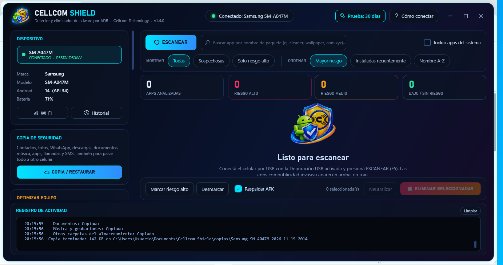
   <em>Pantalla principal: dispositivo, copia de seguridad, optimización, pantalla remota y lista de apps con su puntaje de riesgo.</em>

<table>
  <tr>
    <td width="50%">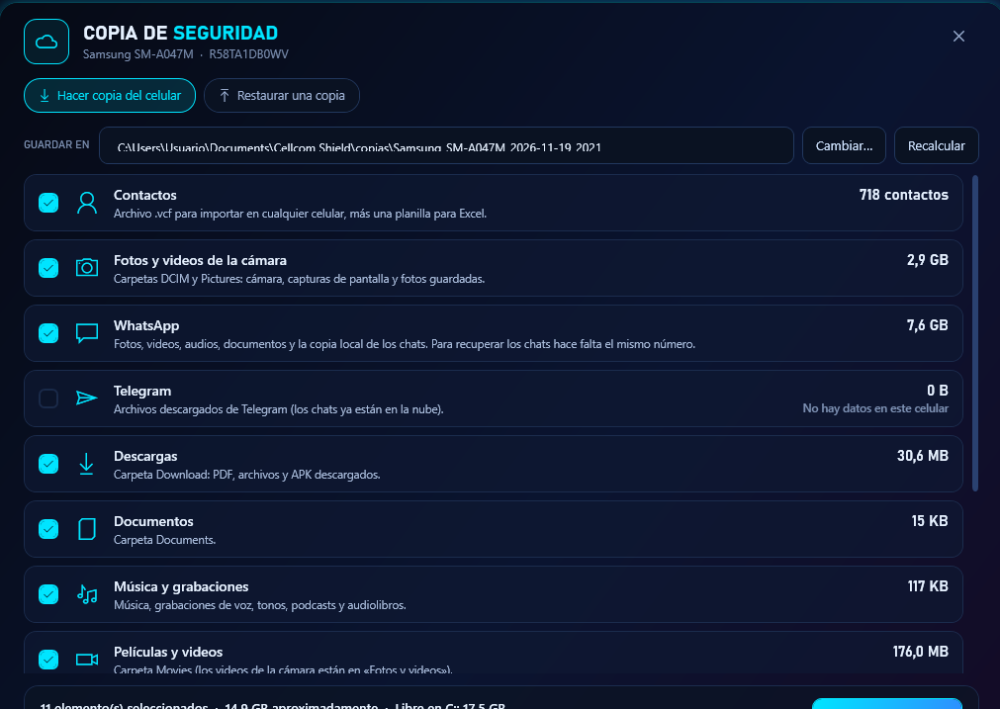 <em>Copia de seguridad: elegí qué respaldar y mirá cuánto ocupa cada cosa.</em></td>
    <td width="50%">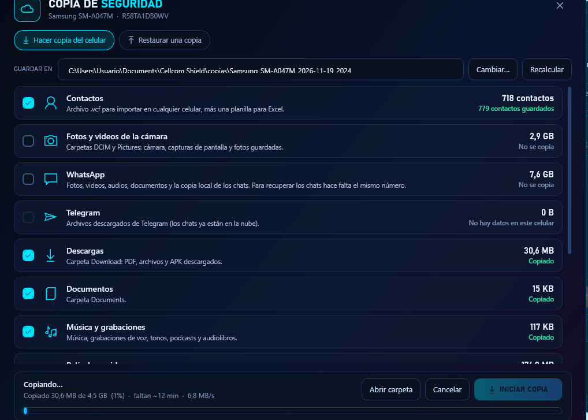 <em>Progreso con velocidad y tiempo restante.</em></td>
  </tr>
  <tr>
    <td width="50%">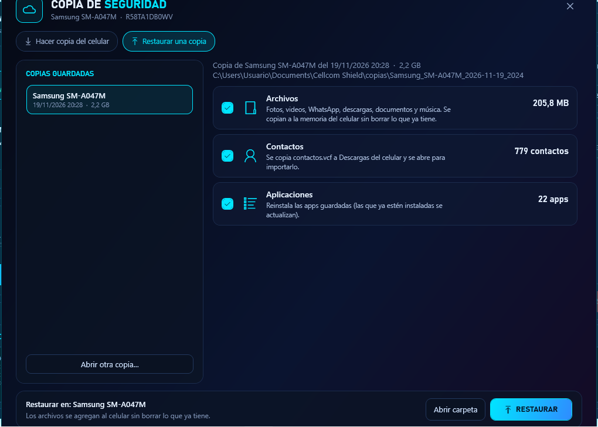 <em>Restaurar una copia en el mismo celular o en uno nuevo.</em></td>
    <td width="50%">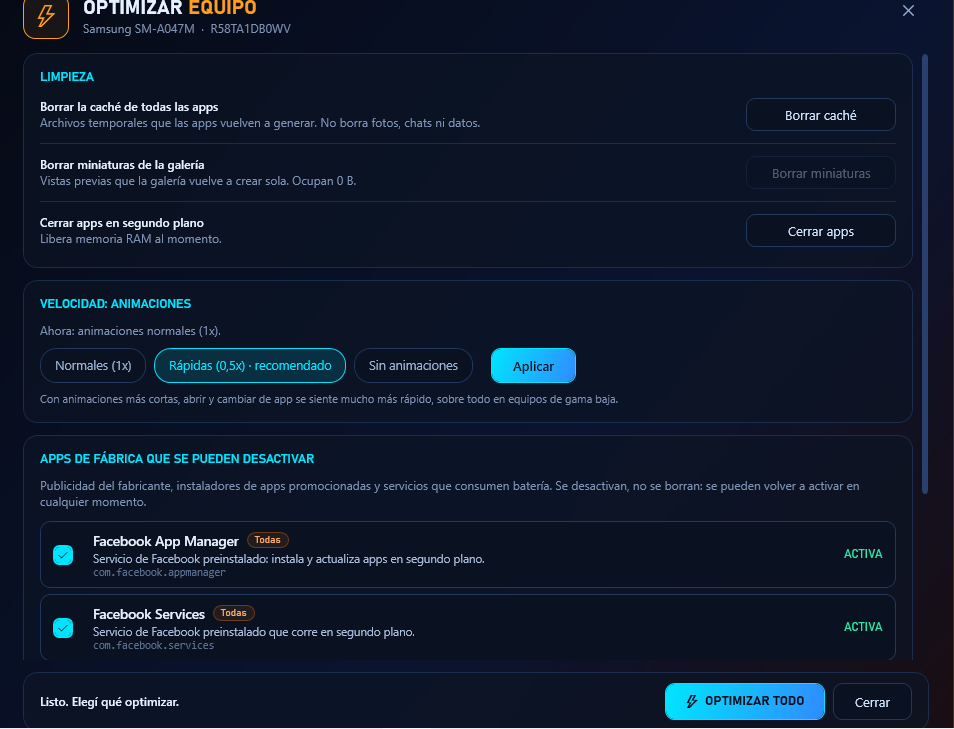 <em>Optimizar: limpieza, animaciones y apps de fábrica.</em></td>
  </tr>
  <tr>
    <td width="50%">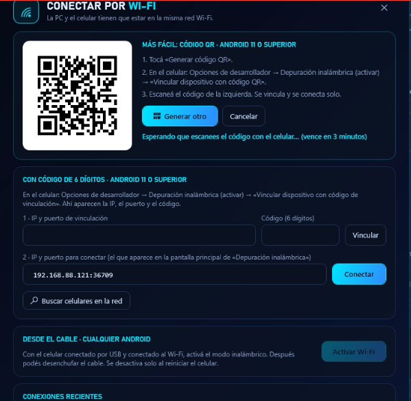 <em>Conexión por Wi-Fi: escaneá el QR y se conecta solo.</em></td>
    <td width="50%">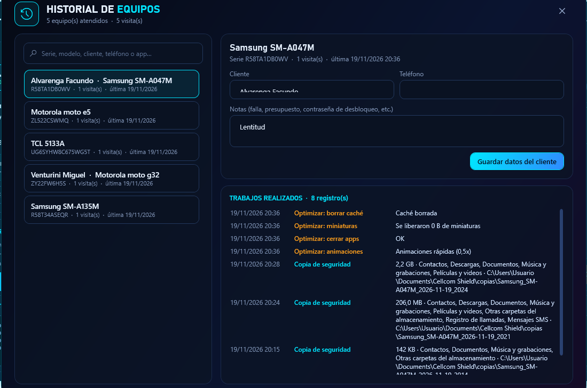 <em>Historial por cliente con todos los trabajos realizados.</em></td>
  </tr>
  <tr>
    <td width="50%">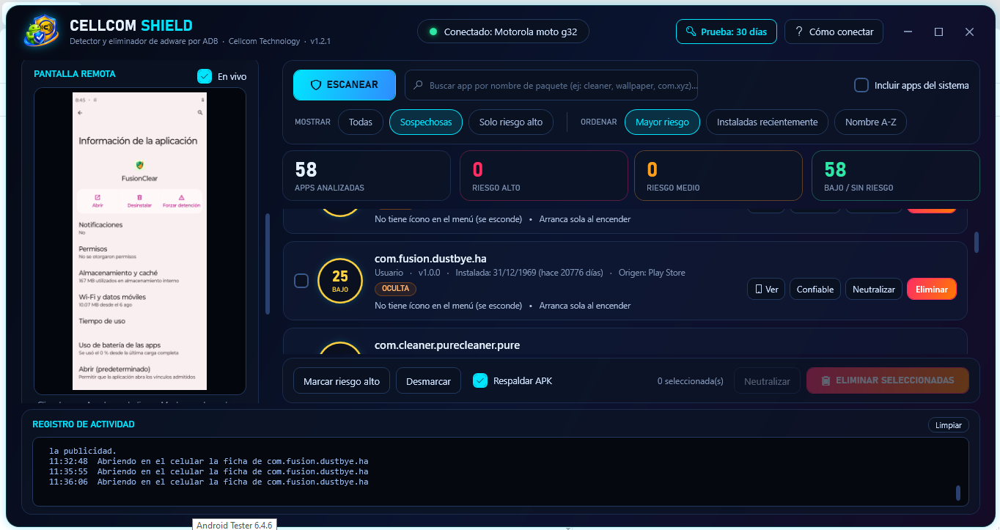 <em>«Detectar ahora»: qué app está mostrando la publicidad.</em></td>
    <td width="50%">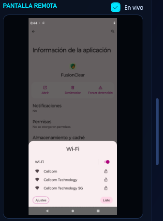 <em>Pantalla remota: manejá el celular desde la PC.</em></td>
  </tr>
  <tr>
    <td width="50%">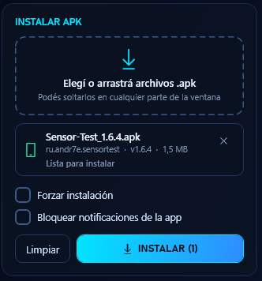 <em>Instalación de APK: normal, forzada y sin notificaciones.</em></td>
    <td width="50%">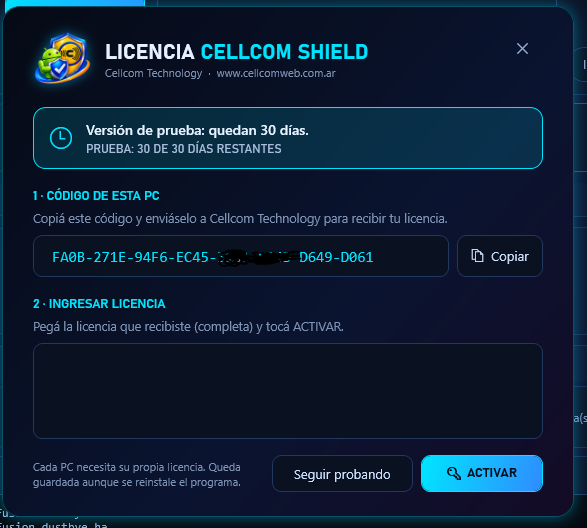 <em>Prueba de 30 días y activación de licencia.</em></td>
  </tr>
</table>

---

## ✨ Qué hace

### 🔍 Detección inteligente de adware
Analiza todas las apps del celular y le asigna a cada una un **puntaje de riesgo de 0 a 100**. Tiene en cuenta si la app:

- se **dibuja encima de otras apps** (superposición), o está mostrando una ventana flotante **en este momento**;
- tiene la **accesibilidad activa**, lo que le permite leer y controlar la pantalla;
- es **administrador del dispositivo**, lo que bloquea su desinstalación;
- **esconde su ícono** del menú y **arranca sola** al encender;
- se instaló **fuera de la tienda oficial** o hace muy pocos días;
- tiene un **nombre típico de app basura** (limpiador, booster, linterna…) o un **nombre aleatorio u ofuscado**.

Las de **riesgo alto** quedan arriba, en rojo, y cada una muestra los motivos explicados en castellano. Podés ver **todas las apps**, ordenarlas por riesgo, por **instaladas recientemente** o por nombre, y con el botón **Ver** abrir la ficha de cualquier app en el celular para ver su nombre real y su ícono.

### 🗑️ Eliminación que sí funciona
Muchas apps de adware no se dejan desinstalar. Cellcom Shield las desarma en el orden correcto:

1. les quita el permiso de **administrador del dispositivo**;
2. les quita la **accesibilidad** y la **lectura de notificaciones**;
3. les bloquea la **superposición** y la ejecución en segundo plano;
4. las **cierra**;
5. las **desinstala**. Si el sistema no lo permite, las deja **desactivadas** para que no se ejecuten más.

Opcionalmente guarda una **copia del APK** en cuarentena antes de borrar.

### 🎯 ¿Qué app muestra la publicidad?
Cuando aparece la propaganda en el celular, tocás **DETECTAR AHORA** y el programa te dice qué app la está mostrando, con un botón para eliminarla en el momento.

### 📱 Pantalla remota
Ves la pantalla del celular en la PC y la manejás con el mouse: **clic** para tocar, **arrastrar** para deslizar y **mantener** para un toque largo. También tenés botones de Atrás, Inicio, Recientes y Encendido, y un campo para escribir texto. Es ideal cuando la publicidad **bloquea el touch**.

### 💾 Copia de seguridad y restauración
Respaldá el celular antes de trabajar:

- **Contactos**: archivo `.vcf` para importar en cualquier celular y planilla para Excel.
- **Fotos y videos**, **WhatsApp** (archivos y copia local de chats), **Telegram**, **descargas**, **documentos**, **música y grabaciones** y el resto del almacenamiento.
- **Apps instaladas** (APK) para reinstalarlas.
- **Registro de llamadas** y **SMS**, en los equipos que lo permiten.

Antes de copiar muestra el tamaño de cada cosa y el espacio libre. Durante la copia muestra el progreso, la velocidad y el tiempo restante. Después restaurás todo en el mismo celular o en uno nuevo.

### ⚡ Optimización
Borra la caché de las apps y las miniaturas de la galería, cierra las apps en segundo plano y acelera las animaciones. También desactiva las apps de fábrica con publicidad de **Samsung, Xiaomi y Motorola**. Se pueden volver a activar cuando quieras, y con **OPTIMIZAR TODO** hacés todo con un clic.

### 📦 Instalar APK
Elegís o arrastrás uno o varios `.apk` y los instalás en el equipo conectado:

- **Normal:** instala o actualiza conservando los datos.
- **Forzada:** permite versiones anteriores y APK de prueba, otorga todos los permisos y evita el bloqueo de Play Protect. Si la firma no coincide, reemplaza la app existente.
- **Bloquear notificaciones:** la app queda instalada sin poder mostrar avisos.

### 📶 Conexión por Wi-Fi
Trabajá sin cable:

- **Android 11 o superior:** escaneá un **código QR** desde *Depuración inalámbrica* y se conecta solo, o usá el código de 6 dígitos.
- **Cualquier Android:** activá el modo inalámbrico desde el cable con un clic.

### 🗂️ Historial por cliente
Cada equipo queda registrado por su número de serie, con **nombre, teléfono y notas** del cliente. Al conectar un celular que ya vino, te avisa y muestra todo lo que se le hizo: apps eliminadas, copias, instalaciones y optimizaciones. Podés buscar por serie, modelo, cliente, teléfono o app.

### 🧠 Aprende con cada equipo
- **Lista negra:** cada app de riesgo que eliminás queda anotada. Si aparece en el celular de otro cliente, se marca en rojo al instante.
- **Base de adware compartida:** lo que se detecta en una PC se marca en todas las PCs con Cellcom Shield.
- **Lista blanca:** con el botón «Confiable», una app buena no se vuelve a marcar en ningún equipo.

### 📊 Informes para el taller
Cada acción queda registrada en un **informe mensual** que abre en Excel: fecha, equipo, número de serie, app, acción y resultado.

### 🔄 Actualizaciones automáticas
Cellcom Shield revisa solo si hay una versión nueva, te muestra las novedades y se actualiza con un clic. También podés revisar a mano en *Herramientas → Actualizaciones*.

### 🛡️ Seguro por diseño
- Las apps esenciales del sistema (Ajustes, Teléfono, Google Play Services, etc.) quedan **protegidas** y no se pueden tocar.
- Las apps de fábrica que quites se pueden **restaurar** en cualquier momento.
- Antes de eliminar, siempre te pide confirmación.

---

## 💻 Requisitos

| | |
|---|---|
| **Sistema** | Windows 10 u 11 de 64 bits |
| **Instalación** | No necesita .NET ni nada extra: el instalador trae todo |
| **ADB** | El programa lo descarga solo la primera vez (Android Platform Tools oficial de Google, ~7 MB) |
| **Celular** | Android 5 o superior, con **Depuración USB** activada (Wi-Fi con QR: Android 11 o superior) |
| **Cable** | USB de **datos**, no solo de carga |

---

## 🚀 Instalación

1. Descargá **`CellcomShield-Setup-x.x.x.exe`** desde [**Releases**](https://github.com/Sabalero23/CellcomShield/releases/latest).
2. Ejecutalo y seguí los pasos.
3. Abrí **Cellcom Shield** desde el menú Inicio o desde el Escritorio.
4. La primera vez, tocá **«Descargar ADB oficial»** en el aviso naranja.

> **«Windows protegió su PC»:** el instalador todavía no tiene firma digital. Tocá **Más información → Ejecutar de todas formas**.

Desde la versión 1.4.1, las versiones nuevas se ofrecen solas al abrir el programa.

---

## 📖 Uso rápido

**1 · Activar la depuración USB en el celular**
- *Ajustes → Acerca del teléfono →* tocá **7 veces** «Número de compilación».
- *Ajustes → Opciones de desarrollador →* activá **Depuración USB**.
- En **Xiaomi / Redmi / POCO** activá también **«Depuración USB (ajustes de seguridad)»** e **«Instalar vía USB»**.

**2 · Conectar**
- Conectá el cable y en el celular aceptá **«¿Permitir depuración USB?»**, marcando *Permitir siempre*.
- O usá **Wi-Fi** (botón en la tarjeta *Dispositivo*) y escaneá el código QR.
- El equipo aparece solo en el panel **Dispositivo**.

**3 · Escanear y limpiar**
- Presioná **ESCANEAR** (o **F5**).
- Revisá las apps en rojo y naranja, marcalas y tocá **ELIMINAR SELECCIONADAS**.
- Volvé a escanear para confirmar que el equipo quedó limpio.

### 😵 ¿La publicidad bloquea el touch?
- **Si la depuración ya estaba activa:** usá la **Pantalla remota** desde la PC.
- **Si no estaba activa:** reiniciá el celular en **Modo seguro** (mantené *Apagar* y después mantené *Apagar* otra vez → *Modo seguro*). En modo seguro las apps de terceros no arrancan, así que podés activar la depuración y conectar normalmente.

### 🔒 ¿Una app no se deja desinstalar?
Es **administrador del dispositivo**. Hacé esto:
1. En *Herramientas*, tocá **«Abrir Seguridad»**.
2. Desde la pantalla remota, entrá a *Apps de administración del dispositivo* y desactivala.
3. Volvé a **Eliminar**.

---

## 🔑 Licencia de uso

- Cellcom Shield funciona **30 días de prueba** completos en cada PC.
- Después pide una **licencia**, que queda atada a esa PC.
- La prueba **no se reinicia** desinstalando y volviendo a instalar.

**Para obtener tu licencia:**
1. Abrí Cellcom Shield y tocá **Licencia** (arriba a la derecha).
2. Copiá el **código de tu PC** y envialo a Cellcom Technology.
3. Pegá la licencia que recibas y tocá **ACTIVAR**.

La licencia queda guardada aunque reinstales o actualices el programa.

---

## 🔐 Privacidad

- Cellcom Shield trabaja **en tu PC y con el celular conectado**. **No** envía a ningún lado fotos, contactos, mensajes ni datos personales del cliente.
- Para controlar la prueba y la licencia, al abrirse con internet envía al servidor de licencias de Cellcom Technology solo esto:
  - el **código de la PC** (un identificador anónimo calculado a partir del hardware);
  - el **nombre del equipo** y el **usuario de Windows**;
  - la **versión** del programa y la **fecha de inicio de la prueba**.
- Para la base de adware compartida envía el **nombre de paquete** de las apps de riesgo que se eliminan o se marcan como confiables, y el modelo del celular. No envía el número de serie ni datos del cliente.
- Para buscar actualizaciones, consulta la página pública de *Releases* de este repositorio en GitHub. No envía ningún dato tuyo.
- Los informes, el historial de clientes, las listas, las copias de seguridad y los respaldos de APK se guardan **solo en tu PC**, en `Documentos\Cellcom Shield`.

---

## ❓ Preguntas frecuentes

<b>El celular no aparece o dice «Falta autorizar»</b>

- Revisá que el cable sea de datos y que la *Depuración USB* esté activa.
- Aceptá el cartel *«¿Permitir depuración USB?»* en el celular. Si no aparece, desconectá y volvé a conectar.
- En **Samsung**, instalá el *Samsung USB Driver*. En otras marcas, el driver USB del fabricante.
- Probá con **Herramientas → Reiniciar ADB**.

<b>El código QR no conecta</b>

- La PC y el celular tienen que estar en la **misma red Wi-Fi** (las redes de invitados suelen bloquear la conexión entre equipos).
- Si Windows preguntó si *adb.exe* puede usar la red, tiene que estar **permitido** para redes privadas.
- Probá **Herramientas → Reiniciar ADB** y generá un código nuevo.
- Si igual no funciona, usá la opción del **código de 6 dígitos** de la misma ventana.

<b>¿Puede borrar algo importante del celular?</b>

Las apps esenciales del sistema aparecen como **PROTEGIDA** y no se pueden eliminar. Siempre te pide confirmación antes de borrar, y las apps de fábrica que quites o desactives se pueden **restaurar** o **reactivar**.

<b>Una app buena aparece como sospechosa</b>

El puntaje es una guía: revisá los motivos que muestra. Si es una app legítima, tocá **Confiable** y no se vuelve a marcar en ningún equipo.

<b>¿Qué incluye la copia de seguridad?</b>

Contactos, fotos y videos, WhatsApp, Telegram, descargas, documentos, música, el resto del almacenamiento, las apps instaladas (APK) y, si el celular lo permite, llamadas y SMS. Sin root, Android **no permite** copiar los datos internos de cada app (sesiones, progreso de juegos). Los chats de WhatsApp quedan en la copia local, pero para restaurarlos hace falta el mismo número.

<b>Al instalar un APK dice «Instalar vía USB»</b>

En Xiaomi, Redmi y POCO hay que activar **«Instalar vía USB»** en *Opciones de desarrollador*. Puede pedir iniciar sesión con la cuenta Mi.

<b>¿Cómo actualizo el programa?</b>

Desde la versión 1.4.1 es automático: al abrir Cellcom Shield, si hay una versión nueva aparece un aviso con las novedades y el botón **Descargar e instalar**. También podés revisar en **Herramientas → Actualizaciones**. Si tenés una versión anterior a la 1.4.1, descargá el instalador desde [Releases](https://github.com/Sabalero23/CellcomShield/releases/latest) e instalalo encima.

<b>¿Dónde están los informes, las copias y el historial?</b>

En `Documentos\Cellcom Shield`: `informes` (un CSV por mes que abre en Excel), `copias` (las copias de seguridad), `listas` (lista negra y blanca), `cuarentena` (APK borrados) y `clientes.json` (datos de los clientes). También se abren con los botones de **Herramientas**.

---

## 📬 Contacto

**Cellcom Technology** · Reconquista, Santa Fe, Argentina
🌐 [www.cellcomweb.com.ar](https://www.cellcomweb.com.ar)

Licencias, soporte y consultas: escribinos desde la web.

---

  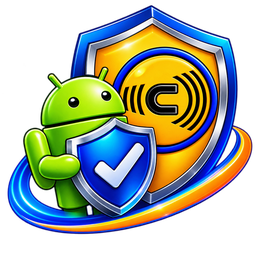 
  © 2026 Cellcom Technology · Todos los derechos reservados. 
  Android es una marca registrada de Google LLC. Cellcom Shield no está afiliado a Google.

